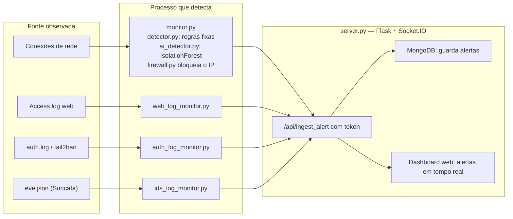

# DataSentinel — Relatório de Estudo

22/11/2026

## Resumo

O DataSentinel é um sistema de detecção de intrusão (IDS) em Python, feito para estudar na prática como ataques de rede são detectados. Ele observa as conexões da máquina, marca IPs suspeitos, bloqueia o IP no firewall e mostra os alertas num dashboard web.

Os testes de 22/11/2026 trouxeram três descobertas:

- **Port scan não era detectado.** O detector só contava conexões; um scan com 1 conexão por porta passava. Corrigido e coberto por teste de regressão.
- **A IA não detecta anomalias novas.** O IsolationForest não consegue julgar valores fora da faixa em que foi treinado. Ajustar o `contamination` ou normalizar as features não resolve.
- **Um teste passava sem provar nada.** O ponto testado entrava no treino antes da previsão. O teste foi corrigido e agora documenta a limitação.

## O problema: detectar intrusão pela rede

Um IDS (Intrusion Detection System) observa o tráfego e avisa quando um padrão parece ataque. Existem duas abordagens principais, e o DataSentinel usa as duas:

- **Por assinatura ou regra:** compara o tráfego com padrões conhecidos, como "mais de 20 conexões em 10 segundos". É previsível e fácil de explicar, mas só pega o que a regra descreve.
- **Por anomalia:** aprende o que é tráfego normal e marca o que foge disso. Em tese pega ataques novos, mas depende de dados de treino bons e pode errar.

O DataSentinel olha só as conexões, sem ler o conteúdo dos pacotes. Por isso ele distingue ataques pelo formato do tráfego:

| Ataque | O que o atacante faz | Como aparece nas conexões |
| --- | --- | --- |
| Brute force | Tenta muitas senhas num serviço, como SSH ou RDP | Muitas conexões do mesmo IP, quase sempre na mesma porta |
| Port scan | Procura serviços abertos para atacar depois | Poucas conexões, mas em muitas portas diferentes |
| Anomalia genérica | Qualquer padrão fora do normal | Combinação de conexões e portas que o histórico não explica |

Ataques no conteúdo, como SQL injection ou XSS, não aparecem nas conexões: só no payload. Por isso o projeto tem monitores separados que leem logs, descritos na próxima seção.

## Como o DataSentinel funciona

O núcleo é o `monitor.py`: a cada ciclo ele lê as conexões da máquina com `psutil`, decide se cada IP é suspeito e reage. Em paralelo, três monitores de log cobrem o que as conexões não mostram. Tudo converge para o `server.py`, que guarda os alertas e alimenta o dashboard.



Cada fonte tem seu próprio processo de detecção; só o `monitor.py` bloqueia IPs. Todos enviam os alertas ao mesmo servidor.

O ciclo de detecção do `monitor.py`:

1. **Filtra conexões de entrada.** Só conta quem conecta numa porta que a máquina escuta. Conexões de saída (navegador, updates) geravam falso port scan, porque cada uma usa uma porta local diferente.
2. **Registra as features do IP** em `detector.py`: conexões nos últimos 10 s e portas distintas nos últimos 60 s.
3. **Decide se é suspeito** por dois caminhos: as regras fixas (20 conexões ou 8 portas) ou a IA (`ai_detector.py`), que só vale a partir de 5 conexões.
4. **Classifica o ataque** como `port_scan`, `brute_force` ou `anomalia`.
5. **Bloqueia o IP na hora** pelo `firewall.py`, com `netsh` no Windows ou `iptables` no Linux.
6. **Alerta sem repetir:** `alerting.py` agrupa ocorrências do mesmo IP e tipo numa janela de 60 s, depois envia ao servidor, grava log e manda e-mail.

Os outros monitores, cada um um processo independente:

| Monitor | Fonte | O que detecta |
| --- | --- | --- |
| `web_log_monitor.py` | Access log do Apache ou nginx | SQL injection e XSS no path ou na query string |
| `auth_log_monitor.py` | `auth.log` e `fail2ban.log` | Brute force contra o SSH do próprio host |
| `ids_log_monitor.py` | `eve.json` do Suricata ou Snort | Alertas das milhares de assinaturas do motor de IDS |

O `server.py` (Flask + Socket.IO) recebe os alertas em `/api/ingest_alert`, protegido por token, salva no MongoDB e empurra cada alerta ao dashboard em tempo real. O login do dashboard tem trava contra brute force a partir da 6ª tentativa.

## O que os testes revelaram

Um teste de ataque simulado numa cópia isolada achou um buraco real e uma limitação de projeto. Os outros componentes passaram.

| Componente | Resultado |
| --- | --- |
| Suíte pytest | 49 passaram, 2 ignorados |
| Dashboard web (login, APIs, token, headers) | Sem problemas |
| Trava de login | Bloqueia na 6ª tentativa |
| Brute force de rede | Detecta, bloqueia e alerta |
| Port scan | Não detectava: corrigido |
| IA (IsolationForest) | Não detecta anomalias novas: limitação documentada |

### 1. Port scan passava sem alarme

Um IP externo tocou 12 portas e o sistema não bloqueou nem alertou. A função `detect_suspicious` só olhava o volume de conexões (20 ou mais). O limiar de 8 portas existia, mas só era usado para dar nome ao ataque depois que algo já tinha disparado.

A correção faz a função disparar por qualquer um dos dois critérios:

```python
def detect_suspicious(ip):
    conns = len(_connections.get(ip, []))
    ports = len(_ports.get(ip, {}))
    return conns >= THRESHOLD or ports >= PORT_SCAN_THRESHOLD
```

O teste de regressão foi escrito antes da correção e falhou com o código antigo, o que confirmou o bug. Depois da correção, passou.

### 2. A IA não detecta o que nunca viu

Treinado com tráfego normal, o IsolationForest classificou como normal até `[9999, 9999]`. O relatório inicial sugeria três ajustes; testados, só um funciona:

| Ajuste sugerido | Resultado no teste | Por quê |
| --- | --- | --- |
| Subir `contamination` de 0.01 para 0.05 | Não muda nada | O tráfego normal tem só 6 pontos distintos; os scores empatam e o limiar fica igual |
| Normalizar as features | Não muda nada | O modelo corta entre o mínimo e o máximo de cada feature, então a escala não importa |
| Regra de guarda por valor fixo | Funciona | Não depende do modelo, mas repete o que as regras do item 1 já fazem |

A causa: o IsolationForest isola pontos com cortes aleatórios dentro da faixa vista no treino. Um ponto muito acima do máximo cai na mesma folha do maior ponto normal e recebe o mesmo score. O modelo não extrapola.

### 3. Um teste que não podia falhar

`test_extreme_traffic_is_flagged` passava, apesar da limitação acima. A função `ai_detect()` grava a amostra no dataset e retreina antes de prever, então o ponto extremo entrava no treino e era reconhecido como raro.

O teste agora treina só com tráfego normal antes de avaliar e está marcado como `xfail(strict=True)`. Quando o modelo for trocado e passar a detectar, o pytest acusa, e a marcação deve sair.

## Lições aprendidas

**Regras fixas e IA se complementam, mas a regra vem primeiro.** As regras pegam com certeza o que descrevem e são fáceis de explicar num alerta. A IA só ajuda se o modelo for capaz de reconhecer o que nunca viu, e isso precisa ser testado, não assumido.

**Um limiar definido não é um limiar usado.** `PORT_SCAN_THRESHOLD` existia e tinha nome certo, mas ficava só na classificação. Vale conferir que cada regra de detecção realmente consegue disparar o alarme sozinha.

**Conheça o algoritmo antes de ajustar parâmetros.** As duas sugestões mais intuitivas para a IA (mais `contamination`, normalizar) não mudavam nada. Entender como o IsolationForest isola pontos mostrou por quê em poucos minutos.

**Um teste precisa conseguir falhar.** Escrever o teste antes da correção e vê-lo falhar prova que ele mede o bug. O teste da IA passava por um efeito colateral do código, e por isso escondia a limitação em vez de mostrá-la.

**Ataque simulado acha o que teste unitário não acha.** A suíte estava verde com 49 testes, e mesmo assim um port scan real passava. Simular o ataque de ponta a ponta revelou o buraco.

**Publicar código exige revisar o histórico.** Antes de abrir o repositório, a varredura confirmou que `.env`, `tfstate` e `tfvars` nunca foram commitados. Mas o e-mail pessoal estava no autor de todos os commits, e os PRs antigos guardam esses commits para sempre. A solução foi um repositório novo com o histórico reescrito para o e-mail `noreply` do GitHub.

## Próximos passos

- [ ] **Trocar o modelo de anomalia.** Testar z-score ou MAD sobre o histórico de cada feature, que medem a distância da média e funcionam para valores fora da faixa. Remover o `xfail` quando o teste passar.
- [ ] **Instalar as dependências no venv** com `venv\Scripts\pip install -r requirements.txt` (falta o `pymongo`) e rodar a suíte completa.
- [ ] **Adicionar um teste de ponta a ponta do port scan** que simule o ciclo inteiro do `monitor.py`: detecção, bloqueio e alerta.
- [ ] **Preparar o deploy de produção:** definir `DATASENTINEL_SECRET_KEY`, `DATASENTINEL_ADMIN_USER`, `DATASENTINEL_ADMIN_PASSWORD` e `DATASENTINEL_INGEST_TOKEN` por variável de ambiente. Sem elas, o sistema gera valores temporários a cada restart e as sessões caem.
- [ ] **Ativar `DATASENTINEL_FORCE_SECURE_COOKIE=1`** quando o dashboard estiver atrás de HTTPS.
- [ ] **Avaliar um port scan lento.** Um atacante que toca 1 porta por minuto fica abaixo do limiar de 8 portas em 60 s. Estudar janelas mais longas ou contagem acumulada por IP.
